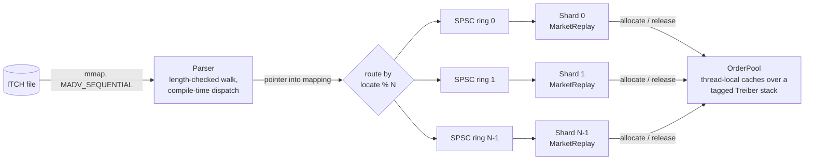

# L3 limit order book and concurrent memory allocator (Nasdaq ITCH 5.0)

This project rebuilds every exchange order book from a raw Nasdaq TotalView-ITCH 5.0 feed,
tracking each resting order individually (Level 3). It has three parts:

- a zero-copy parser over a memory-mapped file;
- an O(1) price-indexed book built from intrusive lists;
- a lock-free order allocator, plus a sharded multi-threaded pipeline.

It is validated message by message against a full trading day of real Nasdaq BX data.

| Result (full 2019-12-30 Nasdaq BX day, 29.2M messages, Apple M3 Pro) | |
| --- | --- |
| Parse only | 130 to 177M msg/s (5.7 ns/msg) |
| L3 books for all 7,380 symbols, one thread | 14 to 25M msg/s |
| L3 books, parser thread plus 8 shard threads | 74 to 94M msg/s |
| Reconstruction errors against an independent reference book | 0 |
| p99 allocation latency, 1 / 2 / 4 threads | under 16 / 27 / 53 ns |

## Architecture



- **Parser** ([parser.hpp](include/itch/parser.hpp), [messages.hpp](include/itch/messages.hpp)):
  - Messages are packed structs that alias the mapped bytes. Accessors byte-swap on read with
    `__builtin_bswap*`, so nothing is copied into a buffer.
  - Each message's length is checked against a `constexpr` table generated from the ITCH 5.0
    specification. `static_assert`s tie every struct layout to that table.
  - Visitor dispatch is resolved at compile time with `if constexpr (requires ...)`.
- **Order book** ([order_book.hpp](include/itch/order_book.hpp)):
  - Each side keeps a flat array of price levels over a sliding window of the Reg NMS tick grid:
    $0.0001 steps below $1, $0.01 from $1.
  - Each level is an intrusive FIFO list of `Order` nodes, so the book makes no per-level or
    per-node heap allocation.
  - A two-level bitmap tracks occupied levels. Lookup by reference uses an open-addressing hash
    map.
- **Allocator** ([order_pool.hpp](include/itch/order_pool.hpp)):
  - A fixed mmap'd slab of 40-byte `Order` slots.
  - Threads allocate and release through a private cache of up to 128 slot indices.
  - Full 64-slot batches move between threads through a Treiber stack. Its head packs
    {pointer, 64-bit tag} into one 128-bit word, updated by a single 128-bit compare-and-swap
    (`caspal` on arm64, `cmpxchg16b` on x86-64). The tag changes on every push and pop, so ABA
    is impossible.
- **Pipeline** ([sharded_replay.hpp](include/itch/sharded_replay.hpp),
  [spsc_ring.hpp](include/itch/spsc_ring.hpp)):
  - The calling thread parses and routes each order message to the shard that owns its symbol.
    The message travels as a pointer through a wait-free single-producer/single-consumer ring.
  - One symbol is always handled by one thread in feed order, so the books need no locks.
  - Ring counters live on separate cache lines. Each side caches the other's counter, so cores
    exchange cache lines once per batch, not once per message.

## Complexity

W = window width in levels (default 1,024, at most 4,096). k = levels outside the window
(typically 0 to a few).

| Operation | Time | Mechanism |
| --- | --- | --- |
| Add order at a price inside the window | O(1) amortised | Grid index by arithmetic, tail append, set one bitmap bit, hash insert |
| Execute or cancel (partial) | O(1) | Hash lookup, subtract shares |
| Delete, or execute in full | O(1) | Unlink from intrusive list; clear bitmap bit if level empties |
| Replace | O(1) | Delete plus add, so the order loses time priority |
| Best bid or ask | O(1) | `clz`/`ctz` on a single summary word (64 x 64 bits covers 4,096 levels), then on one level word |
| Price outside the window | O(log k) | `std::map` overflow; 99.96% of real adds avoid it |
| Re-centre the window | O(W + k log k) | Only when the touch leaves the window |
| Allocate or release an order slot | O(1), lock-free | Thread-local array; one 128-bit CAS per 64 operations |
| Ring push and drain | O(1) per element, wait-free | One release store per push; one per drained batch |

Memory: 40 bytes per resting order, plus 2 x W x 24 bytes of level array per active symbol.

## Validation

All tests use Catch2 and run with `ctest`. The suite is clean under ThreadSanitizer,
AddressSanitizer and UBSan, and compiles with no warnings under
`-Wall -Wextra -Wpedantic -Wshadow -Wconversion`.

- **Real data, message by message** ([historical_tests.cpp](tests/historical_tests.cpp)):
  - Replays all 26.7M order messages of the day alongside a deliberately naive `std::map` /
    `std::list` oracle ([reference_book.hpp](tests/reference_book.hpp)).
  - After every message, it compares the status and the touched symbol's BBO.
  - Every 10M messages and at the end, it diffs all 7,380 books in full: levels, FIFO order,
    references and open shares.
  - Result: 0 differences and 0 unknown, duplicate or over-executed references.
  - 100% of executions hit the order at the reconstructed best price and the front of its queue.
    That is an independent check that price-time priority was rebuilt correctly.
- **Real data, sharded against sequential**:
  - At 25%, 50% and 75% of the day (about 55k live orders), the 2-, 4- and 8-shard pipelines
    must produce books identical to the single-threaded replay, symbol by symbol.
  - Also clean under ThreadSanitizer.
- **Order book unit and differential tests**
  ([order_book_tests.cpp](tests/order_book_tests.cpp)):
  - FIFO priority and loss of time priority on replace.
  - Status reporting.
  - Bitmap word boundaries, sub-dollar ticks, window re-centring and off-grid prices.
  - 200k random operations diffed against the oracle.
- **Allocator** ([order_pool_tests.cpp](tests/order_pool_tests.cpp)):
  - Exhaustion and recycling.
  - Cross-thread reuse.
  - An 8-thread stress test with cross-thread frees on a deliberately small pool, so stack heads
    recycle constantly. It asserts that no slot is ever held by two threads and that none leaks.
- **Pipeline** ([sharded_replay_tests.cpp](tests/sharded_replay_tests.cpp)):
  - Ring ordering across threads.
  - Sharded equals sequential on random multi-symbol sessions with 1, 2, 3 and 8 shards.
  - Errors raised on the parser or on a shard thread are rethrown after every thread stops.
- **Parser** ([parser_tests.cpp](tests/parser_tests.cpp)):
  - Every order message type, including `F` and `C`.
  - Zero-copy addresses, with and without mmap.
  - Truncation and length mismatches.

## Measured results

Measured on an Apple M3 Pro (5 performance and 6 efficiency cores) with Apple clang 16 at
`-O3`, with the file already in the page cache. Each figure is the median of 7 to 11 runs.

The machine was not isolated: the load average was 7 to 14 from other applications. Ranges show
the spread across separate benchmark invocations.

**Throughput** (`itch_ingest`). Speedup is measured against the sequential replay.

| Stage | Throughput | Notes |
| --- | --- | --- |
| Parse only | 130 to 177M msg/s, up to 5.2 GB/s | Every field of every order message decoded |
| Sequential L3, all symbols | 14 to 25M msg/s | 40 to 69 ns/msg |
| Sharded L3, 1 shard | 20 to 25M msg/s | Parsing overlaps book updates |
| Sharded L3, 2 shards | 38 to 49M msg/s | About 2x |
| Sharded L3, 4 shards | 85 to 91M msg/s | About 3.5x |
| Sharded L3, 8 shards | 74 to 94M msg/s | Plateau; see below |

Scaling flattens near 90M msg/s (about 11 ns/msg). That fits a bottleneck on the single parser
thread, which must parse (5.7 ns/msg alone) and route every message. At 4 shards, `locate % N`
sends 28.4% of order messages to the busiest shard and 21.6% to the lightest.

Publishing ring entries in batches of 32 was tried and gave no measurable gain over this noise
floor, so the simpler per-message publish was kept.

**Allocation latency** (`itch_alloc_latency`):
- The Apple Silicon timer ticks every 41.67 ns, so one allocation cannot be timed directly. Each
  sample times 16 back-to-back `allocate()` calls and reports their mean.
- Timer overhead is included, not subtracted.
- Each thread keeps 512 live slots, so batches keep cycling through the shared stack.

| Threads | p50 | p99 | p99.9 |
| --- | --- | --- | --- |
| 1 | 2.6 ns | 7.8 to 15.6 ns | 13 to 26 ns |
| 2 | 2.6 ns | 15.6 to 26.1 ns | 18 to 44 ns |
| 4 | 2.6 ns | 23.4 to 52.1 ns | 50 to 162 ns |
| 8 | 5.2 ns | 135 to 203 ns | 442 to 542 ns |

At 8 threads there are more threads than performance cores. Preemption and contention on the
stack head are the likely causes of the larger tail; this has not been profiled.

## Build and run

```sh
./scripts/fetch_sample.sh            # 390 MB download from Nasdaq, 863 MB unpacked into data/
cmake -S . -B build-release -DCMAKE_BUILD_TYPE=Release
cmake --build build-release -j
ctest --test-dir build-release --output-on-failure

./build-release/itch_ingest data/20191230.BX_ITCH_50 11 1 2 4 8   # runs, then shard counts
./build-release/itch_alloc_latency 1 2 4 8                        # thread counts
```

Sanitizer builds:

```sh
cmake -S . -B build-thread -DITCH_SANITIZE=thread && cmake --build build-thread -j
./build-thread/itch_tests
cmake -S . -B build-asan -DITCH_SANITIZE=address,undefined && cmake --build build-asan -j
./build-asan/itch_tests
```

## Code formatting

Install `clang-format`, then configure the project as usual. These targets format or check all
first-party C++ files under `include/`, `src/`, `tests/` and `benchmarks/`:

```sh
cmake --build build-release --target itch_format
cmake --build build-release --target itch_format_check
```

The formatting targets are available only when `clang-format` is on `PATH`; normal builds do not
require it.

The historical tests are skipped when the sample is missing. Set `ITCH_SAMPLE=<path>` to use a
different ITCH 5.0 BinaryFILE.

## Layout

```text
include/itch/   public headers: messages, parser, order book, pool, rings, replay
src/            library implementation
tests/          Catch2 suites, the reference-book oracle, an ITCH stream encoder
benchmarks/     itch_ingest (throughput), itch_alloc_latency (allocator tail latency)
scripts/        fetch_sample.sh
```
